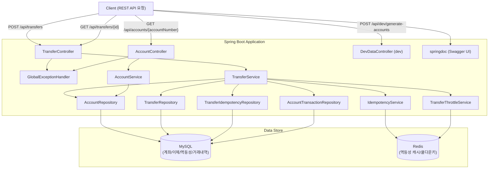
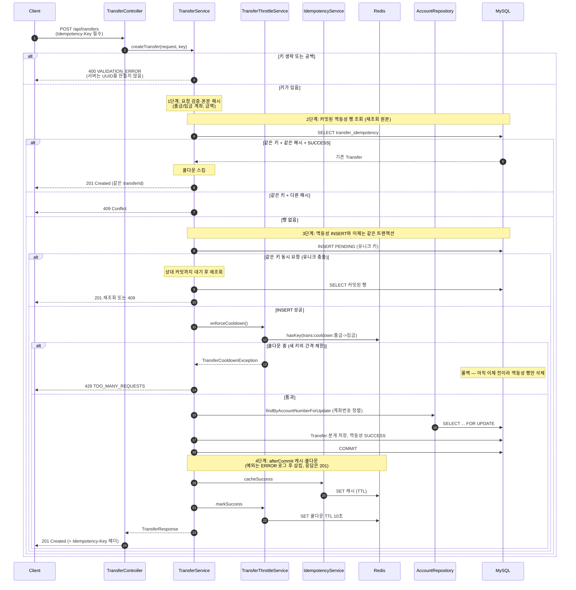
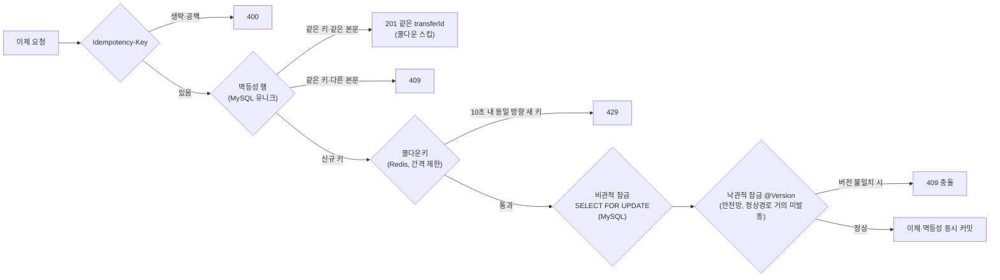

# Bank Transfer System Backend (RESTful)
**긍정적으로 일하고 세상에 도움이 되는 사람이 되자.**
<br>
<br>
안녕하세요 먼저 귀한 시간을 내어 저의 깃허브에 방문해 주신 것에 감사드립니다.<br/>
저는 팀의 일원으로서 팀원들과 함께 좋은 에너지를 만들며 일하고 싶고, 동시에 혼자 고민하는 시간을 통해 전문가로서의 역량을 기르고자 하고 적은 비용으로 어떻게 하면 많은 효과를 누릴 수 있을까? 하고 생각하는 개발자입니다.
<br>
<br>
이 프로젝트는 은행 이체 REST API를 통해 **MySQL 동시성 정합성·멱등성**과 **Redis 캐시/쿨다운**을 중심으로 구현했으며, 대량 데이터 **인덱스 조회**도 함께 실험했습니다.

## 목차

- [기술 스택](#기술-스택)
- [이 프로젝트에서 증명하는 것](#이-프로젝트에서-증명하는-것)
- [프로젝트 구조](#프로젝트-구조)
- [실행 방법](#실행-방법)
  - [사전 요구사항](#사전-요구사항)
  - [설정](#설정)
  - [애플리케이션 실행](#애플리케이션-실행)
- [API 목록](#api-목록)
  - [빠른 체험 (curl 예시)](#빠른-체험-curl-예시)
- [테스트](#테스트)
- [아키텍처 다이어그램](#아키텍처-다이어그램)
  - [시스템 구성도](#1-시스템-구성도)
  - [이체 처리 흐름](#2-이체-처리-흐름-sequence-diagram)
  - [다층 보호 구조](#3-다층-보호-구조)
- [동시성·트랜잭션 설계](#동시성트랜잭션-설계)
  - [배경 실험](#배경-실험-앱-코드가-아닌-mysql-세션-실험)
  - [@Version / 멱등성키 / 쿨다운키](#version--멱등성키--쿨다운키)
  - [데드락 방지 전략](#데드락deadlock-방지-전략)
- [인덱스 실험](#인덱스-실험)
  - [재현 방법](#재현-방법)
  - [주요 인덱스](#프로젝트에-정의된-주요-인덱스)
  - [측정 결과](#측정-결과-참고)
- [다른 포트폴리오](#다른-포트폴리오)

## 기술 스택

| 구분 | 기술 |
|------|------|
| Language | Java 17 |
| Framework | Spring Boot 3.3.4 |
| ORM | Spring Data JPA (Hibernate) |
| Database | MySQL 8 |
| Cache | Redis (멱등성 캐시 / 쿨다운키). 재조회 원본은 MySQL |
| API Docs | springdoc-openapi 2.6.0 (Swagger UI) |

## 이 프로젝트에서 증명하는 것

- `SELECT ... FOR UPDATE` + **계좌번호 정렬 잠금**으로 교차 이체 데드락 방지
- MySQL **Idempotency-Key**(이체와 같은 트랜잭션, 유니크 인덱스)로 중복 이체를 막고, Redis **쿨다운 키**로 연속 요청 간격을 제한
- MySQL **Serializable 세션 실험**에서 락 대기 타임아웃을 확인한 뒤, **REPEATABLE READ + 비관적 잠금**으로 전환한 근거 문서화
- `@Version` 낙관적 잠금을 비관적 잠금의 **추가 안전망**으로 배치 (정상 이체 경로에서는 거의 발동하지 않음)
- 멱등성 결과는 이체와 **같은 MySQL 트랜잭션**에 커밋하고, Redis 캐시·쿨다운만 **afterCommit**에 기록합니다. 커밋 후 Redis가 실패해도 이미 커밋된 이체는 `201`이며, 같은 키 재요청은 MySQL에서 같은 `transferId`를 돌려 두 번째 출금을 만들지 않습니다.
- 약 200만 건 고객 데이터로 **복합 인덱스** 조회 실험

## 프로젝트 구조

```
BankTransferSys_Backend_Restful/
├── .env.example          # 환경 변수 템플릿 (실제 시크릿은 .env, 커밋 제외)
├── build.gradle
├── settings.gradle
├── gradlew / gradlew.bat
├── gradle/wrapper/
└── src/main/
    ├── java/com/banktransfer/
    │   ├── config/           # IdempotencyProperties, RedisConfig, TransferThrottleProperties
    │   ├── controller/       # Transfer, Account, DevData(dev 전용)
    │   ├── dto/
    │   ├── exception/        # GlobalExceptionHandler + 도메인 예외
    │   ├── model/            # JPA 엔티티(Account, Customer, Transfer, AccountTransaction, TransferIdempotency)
    │   │                      #  + IdempotencyRecord(Redis 캐시 POJO, 엔티티 아님)
    │   ├── repository/       # TransferIdempotencyRepository 포함
    │   ├── service/          # Transfer, Idempotency(캐시), TransferThrottle, Account
    │   └── util/
    └── resources/
        ├── application.properties
        └── application-dev.properties

src/test/
├── java/com/banktransfer/
│   ├── TransferConcurrencyIT.java      # 동시성 정합성 통합 테스트
│   ├── TransferIdempotencyIT.java      # 멱등성/쿨다운 통합 테스트
│   ├── TransferCommitCacheFailureIT.java # 커밋 후 Redis/쿨다운 실패 통합 테스트
│   └── support/AbstractIntegrationIT.java # 로컬 MySQL/Redis 통합 테스트 기반 클래스
└── resources/
    └── application-test.properties
```

## 실행 방법

### 사전 요구사항

- JDK 17+
- MySQL 8  
  - 앱 실행: `bank_TransferSys`  
  - 통합 테스트: `bank_transfer_test` (없으면 JDBC가 생성, 테스트 종료 시 `create-drop`으로 스키마 정리)
- Redis (기본 포트: `6379`)  
  - 앱: DB index `0`  
  - 통합 테스트: DB index `1` (앱 데이터와 분리)

### 설정

DB 계정/비밀번호는 저장소에 넣지 않습니다. `.env.example`을 참고해 로컬에서 환경 변수를 설정하세요. (셸 export 또는 IDE Run Configuration에 주입해주세요.)

| 환경 변수 | 기본값 / 필수 | 설명 |
|-----------|---------------|------|
| `DB_HOST` / `DB_PORT` / `DB_NAME` | `127.0.0.1` / `3306` / `bank_TransferSys` | MySQL 접속 정보 |
| `DB_USERNAME` / `DB_PASSWORD` | **필수** (기본값 없음) | MySQL 계정 |
| `REDIS_HOST` / `REDIS_PORT` / `REDIS_DATABASE` | `127.0.0.1` / `6379` / `0` | Redis 접속 정보 |

```bash
# 1) 예시 파일 확인
cp .env.example .env   # 값을 채운 뒤 .env는 커밋하지 마세요

# 2) 셸에 환경 변수 주입 후 실행 (macOS / Linux 예시)
export DB_USERNAME='your_mysql_user'
export DB_PASSWORD='your_mysql_password'
./gradlew bootRun
```

```powershell
# Windows PowerShell 예시
$env:DB_USERNAME='your_mysql_user'
$env:DB_PASSWORD='your_mysql_password'
.\gradlew.bat bootRun
```

### 애플리케이션 실행

```bash
# Windows
gradlew.bat bootRun

# macOS / Linux
./gradlew bootRun
```

- 기본 포트: `8080`
- Swagger UI: [http://localhost:8080/swagger-ui.html](http://localhost:8080/swagger-ui.html)
- OpenAPI JSON: [http://localhost:8080/api-docs](http://localhost:8080/api-docs)

## API 목록

| Method | Path | 설명 |
|--------|------|------|
| POST | `/api/transfers` | 이체 생성 (`Idempotency-Key` 필수. 생략·공백은 400, 서버는 키를 생성하지 않음) |
| GET | `/api/transfers/{id}` | 이체 조회 |
| GET | `/api/accounts/{accountNumber}` | 계좌번호로 계좌 조회 |
| POST | `/api/dev/generate-accounts` | dev profile 전용 — 더미 고객·계좌 약 200만 건 생성 |

### 빠른 체험 (curl 예시)

앱이 `8080`에서 실행 중이고, 출금/입금 계좌가 DB에 이미 있어야 합니다. (Windows는 `curl` 대신 `curl.exe`를 권장합니다.)

**1) 이체 생성** — `POST /api/transfers`

```bash
curl -i -X POST "http://localhost:8080/api/transfers" \
  -H "Content-Type: application/json" \
  -H "Idempotency-Key: demo-key-001" \
  -d "{\"sourceAccountNumber\":\"1000000001\",\"targetAccountNumber\":\"1000000002\",\"amount\":1000}"
```

성공 시 응답 예시 (`201 Created`, 응답 헤더에 `Idempotency-Key: demo-key-001`):

```json
{
  "transferId": 1,
  "status": "COMPLETED",
  "executedAt": "2026-07-29T18:30:00",
  "sourceAccountNumber": "1000000001",
  "targetAccountNumber": "1000000002",
  "amount": 1000,
  "currencyCode": "KRW",
  "sourceBalanceAfter": 99000,
  "targetBalanceAfter": 11000
}
```

`Idempotency-Key`는 필수입니다. 헤더를 빼거나 공백만 보내면 `400 VALIDATION_ERROR`이고, 서버는 UUID를 만들지 않습니다. 키는 최대 128자이며 앞뒤 공백은 제거합니다.

같은 키와 같은 본문(출금 계좌, 입금 계좌, 금액)으로 다시 호출하면 이중 이체 없이 **처음 이체의 `transferId`**를 `201`으로 반환합니다. 같은 키와 다른 본문은 `409 Conflict`이며 두 번째 이체를 만들지 않습니다.

**2) 이체 조회** — `GET /api/transfers/{id}`

```bash
curl -i "http://localhost:8080/api/transfers/1"
```

응답 본문 필드는 위 `TransferResponse`와 동일합니다 (`200 OK`).

## 테스트

로컬에서 실행 중인 MySQL·Redis에 연결해 동시성·멱등성 통합 테스트를 검증합니다. (Docker / Testcontainers 불필요)

| 구분 | 앱 (`bootRun`) | 테스트 (`test`) |
|------|-----------------|-----------------|
| MySQL DB | `bank_TransferSys` | `bank_transfer_test` |
| Redis DB index | `0` | `1` |
| 스키마 | `ddl-auto=update` (dev) | `ddl-auto=create-drop` |

`DB_USERNAME` / `DB_PASSWORD`는 앱 실행과 동일하게 환경 변수로 주입합니다.

```powershell
# Windows (PowerShell)
$env:DB_USERNAME='your_mysql_user'
$env:DB_PASSWORD='your_mysql_password'
.\gradlew.bat test
```

```bash
# macOS / Linux
export DB_USERNAME='your_mysql_user'
export DB_PASSWORD='your_mysql_password'
./gradlew test
```

| 테스트 클래스 | 검증 내용 |
|--------------|----------|
| `TransferConcurrencyIT` | 동일 출금 계좌 동시 이체 잔액 정합성, 교차 이체(A↔B) 데드락 부재 |
| `TransferIdempotencyIT` | 키 생략·공백 400, 동일 키 재요청/동시 요청 단일 이체, 완료 재조회는 쿨다운 스킵, 새 키 429, payload 충돌 409, 커밋 전 실패 후 같은 키 재사용 |
| `TransferCommitCacheFailureIT` | 커밋 후 쿨다운 기록 실패에도 201, 같은 키 재요청은 같은 transferId이며 잔액은 다시 움직이지 않음 |

## 아키텍처 다이어그램

### 1. 시스템 구성도



### 2. 이체 처리 흐름 (Sequence Diagram)



### 3. 다층 보호 구조



> **역할 구분:** 재조회 원본은 MySQL입니다. 완료된 같은 키 재시도는 쿨다운(429)보다 먼저 처리합니다. 쿨다운은 **요청 간격 제한**이고 이중 출금 방지가 아닙니다. 이중 출금은 이체와 같은 트랜잭션의 유니크 키가 막습니다. `FOR UPDATE`는 잔액 정합성, `@Version`은 비관적 잠금이 누락된 경로를 대비한 보조 계층입니다.

---

## 동시성·트랜잭션 설계

### 배경 실험 (앱 코드가 아닌 MySQL 세션 실험)

정합성이 중요한 이체 도메인에서 **격리 수준만으로** 문제를 풀 수 있는지 확인하기 위해, 애플리케이션이 아닌 **MySQL 클라이언트 두 세션**으로 Serializable을 실험했습니다.

- **가설:** Serializable이면 정합성이 가장 높아 이체 시스템에 적합할 것이다.
- **시나리오:** 세션1이 레코드 A를 갱신한 뒤 커밋하지 않은 상태에서, 세션2가 동일 레코드 A에 차감을 시도.
- **결과:** 후속 요청이 선행 트랜잭션 종료까지 대기하다 **락 대기 타임아웃**으로 실패.

**같은 레코드에 대하여 요청한 쿼리:**


**타임아웃이 발생하여 연결이 끊어짐:**


**문제점 분석:**  
동일 레코드에 대한 동시 쓰기 경쟁이 커지면 대기·타임아웃이 늘어 처리량이 급격히 떨어질 수 있습니다. Serializable은 정합성은 높지만, 동시 읽기·대량 처리 관점의 비용이 큽니다. “격리 수준만 올리면 된다”는 접근은 이체 도메인에 그대로 쓰기 어렵다고 판단했습니다.

**애플리케이션에 적용한 해결:**  
MySQL InnoDB 기본 격리 수준인 **REPEATABLE READ**를 유지하고, 이체 시점에만 `SELECT ... FOR UPDATE`로 필요한 계좌를 잠급니다. 여기에 MySQL 멱등성 유니크 키, Redis 쿨다운키, `@Version`을 더해 다층으로 보호합니다.

> **P.S) 격리 수준 설정:** 본 프로젝트 코드에는 `@Transactional(isolation = ...)` 또는 `hibernate.connection.isolation`을 두지 않았습니다. 정합성은 **비관적 잠금 + 낙관적 잠금(안전망)** 으로 보장합니다.

### @Version / 멱등성키 / 쿨다운키

**@Version (낙관적 잠금)**  
엔티티 수정 시 version이 증가하고, UPDATE 시점에 불일치하면 트랜잭션이 실패합니다(`409`). 이체 경로는 이미 `FOR UPDATE`로 직렬화되므로 정상 흐름에서는 거의 발동하지 않습니다. 비관적 잠금이 누락된 코드 경로를 대비한 **저비용 안전망**으로 두었습니다.

**멱등성키 (Idempotency-Key)**  
클라이언트가 발급한 헤더입니다. **필수**이며, 생략·공백은 `400 VALIDATION_ERROR`입니다. 서버는 키를 생성하지 않습니다. 응답이 유실돼도 클라이언트가 같은 키로 다시 보내면 처음 이체를 찾을 수 있습니다.

재조회의 원본은 MySQL `transfer_idempotency`입니다. 이체와 **같은 트랜잭션**에 INSERT하고, 성공 시 그 행을 `SUCCESS`로 바꾸며 `transfer_id`를 연결합니다. `REQUIRES_NEW`로 따로 커밋하지 않습니다. 롤백되면 이체와 멱등성 행이 함께 사라져 같은 키를 다시 쓸 수 있습니다. 실패 상태를 별도 트랜잭션에 남기지 않습니다.

같은 본문 여부는 출금 계좌, 입금 계좌, 금액의 안정적인 해시로 판단합니다.

| 상태 | 응답 |
|------|------|
| 헤더 생략·공백 | `400` — 이체 행 없음. 서버는 UUID를 만들지 않음 |
| 같은 키 + 같은 본문 (`SUCCESS`) | `201 Created` — 원래 `transferId` (**쿨다운 검사 전**) |
| 같은 키 + 다른 본문 | `409 Conflict` — 추가 이체 없음 |
| 커밋 전 실패 (잔액 부족, 검증, 없음 등) | 해당 비즈니스 오류. 멱등성 행도 롤백되어 같은 키 재사용 가능 |
| 같은 키 동시 요청 | 유니크 인덱스에서 대기한 뒤 커밋된 행을 재조회. 이체는 하나 |

- 유니크 인덱스: `transfer_idempotency.uk_transfer_idempotency_key` (`idempotency_key`)
- MySQL `SUCCESS` 행은 TTL로 지우지 않습니다. 지우면 같은 키로 다시 출금할 수 있습니다.
- Redis 캐시 키: `idempo:TRANSFER:{Idempotency-Key}` (요청 경로에서 재조회하지 않음)
- Redis TTL: **24시간(86400s)** — 캐시에만 적용

**P.S) 커밋 후 Redis (캐시·쿨다운)**  
멱등성 `SUCCESS`는 커밋 전에 MySQL에 있습니다. `afterCommit`은 Redis 캐시와 쿨다운만 기록합니다. 여기서 예외가 나면 SLF4J `ERROR`로 남기고 삼키며, HTTP 응답은 바꾸지 않습니다. 이미 커밋된 이체는 `201`이고, 같은 키 재요청은 MySQL을 봐서 같은 `transferId`를 반환합니다. Redis가 죽어도 그 키로 한 번 더 출금되지 않습니다.

| 시점 | 처리 |
|------|------|
| 이체 로직 중 예외 | 트랜잭션 롤백 — 이체와 PENDING 멱등성 행이 함께 삭제 |
| 커밋 성공 | MySQL에 이체 + `SUCCESS`가 이미 있음. `afterCommit`에서 Redis 캐시 + 쿨다운 |
| 커밋 후 Redis/쿨다운 실패 | 이체는 유지. 응답은 `201`. 같은 키 재조회는 MySQL |

**P.S) 같은 키 동시 요청**  
나중 요청은 유니크 인덱스에서 먼저 커밋되는 트랜잭션을 기다린 다음, 커밋된 행을 읽어 재조회하거나(`201`) 본문이 다르면 `409`를 반환합니다. 두 번째 이체를 만들지 않습니다.

**쿨다운키 (Cooldown Key)**  
**동일한 출금 → 입금 방향** 이체가 성공한 뒤 10초 안에 **새 멱등성 키**로 다시 들어오면 `429 Too Many Requests`로 차단합니다. (역방향 B→A는 별도 키.)  
이것은 **요청 간격 제한**입니다. 이중 출금 방지 장치가 아니며, **같은 키 재조회에는 적용하지 않습니다.** 쿨다운이 지나거나 Redis 기록이 실패해도 같은 키는 MySQL 멱등성 행이 막습니다.

- Redis 키: `trans:cooldown:{출금계좌}->{입금계좌}`
- TTL: **10초** (데모용)

### 데드락(Deadlock) 방지 전략

| 시간 순서 | 트랜잭션 A (계좌1 → 계좌2) | 트랜잭션 B (계좌2 → 계좌1) |
|-------|---------------------------|---------------------------|
| 1 | 계좌1 잠금 | 계좌2 잠금 |
| 2 | 계좌2 대기 | 계좌1 대기 |
| 결과 | **데드락** — 서로 상대 잠금 해제 대기 | |

**해결:** 출금/입금 계좌번호를 문자열 기준으로 정렬해 **항상 작은 값부터** 잠급니다.

```java
String first  = sourceAccountNumber.compareTo(targetAccountNumber) <= 0
        ? sourceAccountNumber : targetAccountNumber;
String second = sourceAccountNumber.compareTo(targetAccountNumber) <= 0
        ? targetAccountNumber : sourceAccountNumber;
Account firstAcc  = accountRepository.findByAccountNumberForUpdate(first);
Account secondAcc = accountRepository.findByAccountNumberForUpdate(second);
```

**적용 후:**

| 시간 순서 | 트랜잭션 A (계좌1 → 계좌2) | 트랜잭션 B (계좌2 → 계좌1) |
|-------|---------------------------|---------------------------|
| 1 | 계좌1 잠금 (1 &lt; 2이므로 먼저) | 계좌1 대기 |
| 2 | 계좌2 잠금 | 대기 중 |
| 3 | 이체 완료, 잠금 해제 | 계좌1 잠금 |
| 4 | | 계좌2 잠금 → 이체 완료 |

잠금 획득 순서가 항상 같아 교차 이체에서도 데드락이 발생하지 않습니다.

---

## 인덱스 실험

이체 정합성과는 별도로, MySQL **복합 인덱스·카디널리티·좌측 접두사**를 확인하기 위한 보조 실험입니다.

- **인덱스:** `idx_customer_name_combined (name, bank, gender)` — 카디널리티가 높은 `name`을 앞에 배치
- **조회 조건:** `name LIKE 'ql%'` + `bank = 'WOORI'` + `gender = 'MALE'` (B-Tree 좌측 접두사에 맞춘 조건)

### 재현 방법

1. 애플리케이션을 dev profile로 실행합니다.
2. `POST /api/dev/generate-accounts`로 `customers`에 약 200만 건을 생성합니다.
3. 복합 인덱스가 DDL에 반영되었는지 확인합니다.
4. 아래 쿼리로 `EXPLAIN`과 실행 시간을 비교합니다.

```sql
EXPLAIN
SELECT * FROM customers
WHERE name LIKE 'ql%'
  AND bank = 'WOORI'
  AND gender = 'MALE';
```

### 프로젝트에 정의된 주요 인덱스

| 테이블 | 인덱스명 | 컬럼 | 용도 |
|--------|---------|------|------|
| `customers` | `idx_customer_name_combined` | name, bank, gender | 인덱스 성능 실험 |
| `accounts` | `idx_account_balance` | balance | 잔액 조건 조회 |
| `accounts` | `uq_account_number` | account_number (UNIQUE) | 계좌번호 유일성 |
| `transfers` | `idx_transfer_created_at` | created_at | 최신 이체 내역 조회 |
| `transfer_idempotency` | `uk_transfer_idempotency_key` | idempotency_key (UNIQUE) | 멱등성 키 재조회·동시 중복 차단 |
| `account_transactions` | `idx_account_tx_account` | account_id | 계좌별 거래내역 조회 |
| `account_transactions` | `idx_account_tx_transfer` | transfer_id | 이체별 거래내역 조회 |

### 측정 결과 (참고)

로컬 MySQL에서 동일 조건 조회 시, 인덱스 미적용 약 **0.031s**, 적용 후 약 **0.016s**로 측정되었습니다(약 48% 단축).

**인덱스 사용 전:**


**인덱스 사용 후:**


**P.S) PK:** InnoDB는 PK가 없으면 내부 일련번호 컬럼을 만드는데, 애플리케이션에서 접근할 수 없습니다. 접근 가능한 PK를 명시하는 편이 유리합니다.

---

## 다른 포트폴리오

- [Cursor Agent로 GitHub Copilot을 저렴하게 사용해보기](https://github.com/Pray-T/GitHub-Copilot-With-Cursor.git)
- [AWS에 배포·운영한 JWT+Redis 이중 토큰 인증과 실시간 채팅 웹 앱](https://github.com/Pray-T/ReadyPlz-Production_main.git)

**이상입니다, 저의 깃허브 방문을 감사드립니다.**
