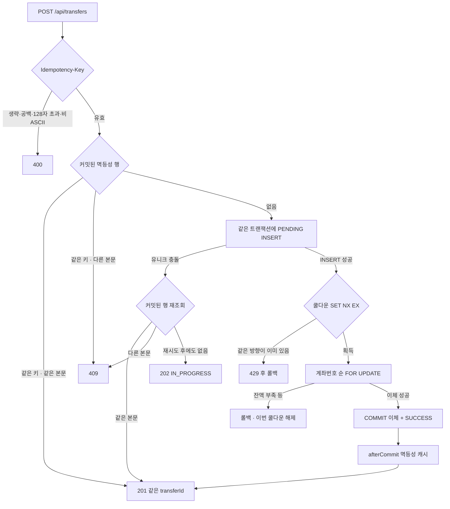
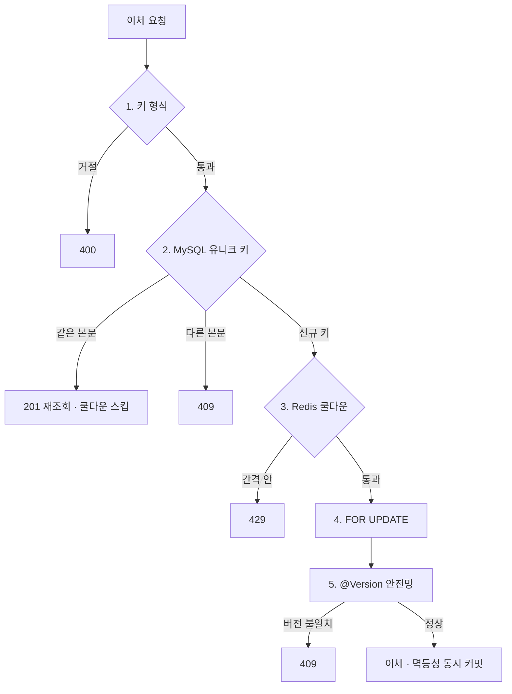

# Bank Transfer System Backend (RESTful)
**긍정적으로 일하고 세상에 도움이 되는 사람이 되자.**
<br>
<br>
안녕하세요 먼저 귀한 시간을 내어 저의 깃허브에 방문해 주신 것에 감사드립니다.<br/>
<br>
이 프로젝트는 Real Mysql 8.0을 읽다가 생겨난 DB에 관한 궁금증으로 시작 프로젝트입니다. **MySQL 동시성 정합성·멱등성**을 중심으로 이체를 구현하고, 부수적으로 **Redis 캐시/쿨다운**을 활용했으며 **복합인덱스의 사용**으로 조회 시간을 실험한 은행 이체를 REST API를 통해 구현한 프로젝트입니다.


## 기술 스택

<details>
<summary>클릭시 펼쳐집니다.</summary>

| 구분 | 기술 |
|------|------|
| Language | Java 17 |
| Framework | Spring Boot 3.3.4 |
| ORM | Spring Data JPA  |
| Database | MySQL 8 (재조회 원본) |
| Cache | Redis (멱등성 캐시 / 쿨다운키)|
| API Docs | springdoc-openapi 2.6.0 (Swagger UI) |

</details>

## 이 프로젝트에서 증명하는 것

- `SELECT ... FOR UPDATE` + **계좌번호 정렬 잠금**으로 교차 이체 데드락 방지
- MySQL의 **Idempotency-Key**(이체와 같은 트랜잭션, 유니크 인덱스) 컬럼으로 중복 이체를 막고, Redis **쿨다운 키**로 연속 요청 간격을 제한합니다.
- MySQL **Serializable 세션 실험**에서 락 대기로 인한 타임아웃을 확인한 뒤, **REPEATABLE READ + 이체 시에만 비관적 잠금**으로 전환합니다.
- `@Version` 낙관적 잠금을 비관적 잠금의 **추가 안전망**으로 배치했습니다. (정상 이체 경로에서는 거의 발동하지 않습니다)
- 멱등성 결과는 이체와 **같은 MySQL 트랜잭션**에 커밋합니다. 쿨다운 키는 커밋 전에 Redis `SET key value NX EX`로 원자적으로 잡습니다. 같은 방향의 새 키가 동시에 들어와도 둘 다 통과하지 못하고, 롤백된 이체는 그 키를 해제합니다. 커밋된 이체는 키를 유지합니다. 같은 키 재조회는 새 쿨다운 획득이 아닙니다. <br>
Redis 멱등성 캐시만 **afterCommit**에 기록하며, 캐시 기록이 실패해도 이미 커밋된 이체는 `201`이고 같은 키 재요청은 MySQL에서 같은 `transferId`를 돌려 두 번째 출금을 만들지 않습니다.

## 프로젝트 구조

<details>
<summary>클릭시 펼쳐집니다.</summary>

```
BankTransferSys_Backend_Restful/
├── .env.example          # 환경 변수 템플릿 (실제 시크릿은 .env, 커밋 제외)
├── build.gradle
├── settings.gradle
├── gradlew / gradlew.bat
├── gradle/wrapper/
└── src/main/
    ├── java/com/banktransfer/
    │   ├── config/           # IdempotencyProperties, RedisConfig, TransferThrottleProperties
    │   ├── controller/       # Transfer, Account, DevData(dev 전용)
    │   ├── dto/
    │   ├── exception/        # GlobalExceptionHandler + 도메인 예외
    │   ├── model/            # JPA 엔티티(Account, Customer, Transfer, AccountTransaction, TransferIdempotency)
    │   │                      #  + IdempotencyRecord(Redis 캐시 POJO, 엔티티 아님)
    │   ├── repository/       # TransferIdempotencyRepository 포함
    │   ├── service/          # Transfer, Idempotency(캐시), TransferThrottle, Account
    │   └── util/             # HashUtil, MoneyUtil(원화 정수)
    └── resources/
        ├── application.properties
        └── application-dev.properties

src/test/
├── java/com/banktransfer/
│   ├── TransferConcurrencyIT.java      # 동시성 정합성 통합 테스트
│   ├── TransferIdempotencyIT.java      # 멱등성/쿨다운 통합 테스트
│   ├── TransferCommitCacheFailureIT.java # 커밋 후 캐시 실패·쿨다운 획득 실패 통합 테스트
│   ├── util/MoneyUtilTest.java         # 원화 금액 단위 테스트
│   ├── repository/TransferCountTestRepository.java # 테스트 전용 완료 건수 조회
│   └── support/
│       ├── AbstractIntegrationIT.java  # 로컬 MySQL/Redis 통합 테스트 기반 클래스
│       ├── TestDatabaseSafetyGuard.java
│       ├── TestDatabaseSafetyGuardTest.java
│       └── TestDatabaseSafetyInitializer.java
└── resources/
    └── application-test.properties
```

</details>

## 실행 방법

<details>
<summary>클릭시 펼쳐집니다.</summary>

### 사전 요구사항

- JDK 17+
- MySQL 8  
  - 앱 실행: `bank_TransferSys`  
  - 통합 테스트: `bank_transfer_test` (JDBC 스키마는 `TEST_DB_NAME`만 사용하고 `DB_NAME`은 스키마로 쓰지 않음. 없으면 JDBC가 생성, `create-drop`은 이 스키마만 정리)
- Redis (기본 포트: `6379`)  
  - 앱: DB index `0`  
  - 통합 테스트: DB index `1` (`TEST_REDIS_DATABASE`. 앱의 `REDIS_DATABASE`와 분리)

### 설정

DB 계정/비밀번호는 저장소에 넣지 않습니다. `.env.example`을 참고해 로컬에서 환경 변수를 설정하세요. (셸 export 또는 IDE Run Configuration에 주입해주세요.)

| 환경 변수 | 기본값 / 필수 | 설명 |
|-----------|---------------|------|
| `DB_HOST` / `DB_PORT` / `DB_NAME` | `127.0.0.1` / `3306` / `bank_TransferSys` | MySQL 접속 정보 |
| `DB_USERNAME` / `DB_PASSWORD` | **필수** (기본값 없음) | MySQL 계정 |
| `REDIS_HOST` / `REDIS_PORT` / `REDIS_DATABASE` | `127.0.0.1` / `6379` / `0` | Redis 접속 정보 |

```bash
# 1) 예시 파일 확인
cp .env.example .env   # 값을 채운 뒤 .env는 커밋하지 마세요

# 2) 셸에 환경 변수 주입 후 실행 (macOS / Linux 예시)
export DB_USERNAME='your_mysql_user'
export DB_PASSWORD='your_mysql_password'
./gradlew bootRun
```

```powershell
# Windows PowerShell 예시
$env:DB_USERNAME='your_mysql_user'
$env:DB_PASSWORD='your_mysql_password'
.\gradlew.bat bootRun
```

### 애플리케이션 실행

```bash
# Windows
gradlew.bat bootRun

# macOS / Linux
./gradlew bootRun
```

`gradlew` 래퍼는 Git에 실행 가능 상태로 저장되어 있습니다. `.gitattributes`가 `gradlew`는 LF, `*.bat`는 CRLF로 유지하므로, 새로 clone하면 별도의 `chmod` 없이 `./gradlew`를 실행할 수 있습니다.

- 기본 포트: `8080`
- Swagger UI: [http://localhost:8080/swagger-ui.html](http://localhost:8080/swagger-ui.html)
- OpenAPI JSON: [http://localhost:8080/api-docs](http://localhost:8080/api-docs)

</details>

## API 목록

| Method | Path | 설명 |
|--------|------|------|
| POST | `/api/transfers` | 이체 생성 (`Idempotency-Key` 필수. 생략·공백·128자 초과·ASCII 아님은 400, 서버는 키를 생성하지 않음) |
| GET | `/api/transfers/{id}` | 이체 조회 |
| GET | `/api/accounts/{accountNumber}` | 계좌번호로 계좌 조회 |
| POST | `/api/dev/generate-accounts` | dev profile 전용 — 더미 고객·계좌 약 200만 건 생성 |

### 빠른 체험 (curl 예시)

<details>
<summary>클릭시 펼쳐집니다.</summary>

```bash
curl -i -X POST "http://localhost:8080/api/transfers" \
  -H "Content-Type: application/json" \
  -H "Idempotency-Key: demo-key-001" \
  -d "{\"sourceAccountNumber\":\"1000000001\",\"targetAccountNumber\":\"1000000002\",\"amount\":1000}"
```

`201 Created` 응답 필드:

```json
{
  "transferId": 1,
  "status": "COMPLETED",
  "executedAt": "2026-07-29T18:30:00",
  "sourceAccountNumber": "1000000001",
  "targetAccountNumber": "1000000002",
  "amount": 1000,
  "currencyCode": "KRW",
  "sourceBalanceAfter": 99000,
  "targetBalanceAfter": 11000
}
```

</details>

## 테스트

| 테스트 클래스 | 검증 내용 |
|--------------|----------|
| `TransferConcurrencyIT` | 동일 출금 계좌 동시 이체 잔액 정합성, 교차 이체(A↔B) 데드락 부재 |
| `MoneyUtilTest` | 정상 정수와 끝자리 0뿐인 소수(`1000.00`)는 scale 0, 소수 값·음수·0은 반올림 없이 거절, 정수로 떨어지는 지수 표기는 평문 정수, 자릿수 초과는 거절, 응답·해시용 scale 0 |
| `TransferIdempotencyIT` | 키 생략·공백·ASCII 아님 400, 동일 키 재요청/동시 요청 단일 이체, 대소문자만 다른 키는 별개 이체, 완료 재조회는 쿨다운 스킵, 새 키 429, payload 충돌 409, 커밋 전 실패 후 같은 키 재사용, 소수·비정상 금액 400, 생성·재응답·조회의 금액 문자열이 같음, 같은 원장 재저장은 거부, 이후 잔액이 바뀌어도 재응답·조회 잔액은 처음 값 |
| `TransferCommitCacheFailureIT` | 커밋 후 멱등성 캐시 실패에도 201이고 같은 키 재요청은 잔액을 다시 움직이지 않음. 쿨다운 획득 중 Redis 실패는 이체를 커밋하지 않음 |

## 아키텍처 다이어그램

### 이체 처리 흐름



### 다층 보호 구조



> **역할 구분:** 재조회 원본은 MySQL입니다. 완료된 같은 키 재시도는 쿨다운(429)보다 먼저 처리합니다. 쿨다운은 **요청 간격 제한**이고 이중 출금 방지가 아닙니다. 이중 출금은 이체와 같은 트랜잭션의 유니크 키가 막습니다. `FOR UPDATE`는 잔액 정합성, `@Version`은 비관적 잠금이 누락된 경로를 대비한 보조 계층입니다.

---

## 동시성·트랜잭션 설계

### 배경 실험 (앱 코드가 아닌 MySQL 세션 실험)

정합성이 중요한 이체 도메인에서 **격리 수준만으로** 문제를 풀 수 있는지 확인하기 위해, 애플리케이션이 아닌 **MySQL 클라이언트 두 세션**으로 Serializable을 실험했습니다.

- **가설:** Serializable이면 정합성이 가장 높아 이체 시스템에 적합할 것이다.
- **시나리오:** 세션1이 레코드 A를 갱신한 뒤 커밋하지 않은 상태에서, 세션2가 동일 레코드 A에 차감을 시도.
- **결과:** 후속 요청이 선행 트랜잭션 종료까지 대기하다 **락 대기 타임아웃**으로 실패.

**같은 레코드에 대하여 요청한 쿼리:**


**타임아웃이 발생하여 연결이 끊어짐:**


**문제점 분석:**  
동일 레코드에 대한 동시 쓰기 경쟁이 커지면 대기·타임아웃이 늘어 처리량이 급격히 떨어질 수 있습니다. Serializable은 정합성은 높지만, 동시 읽기·대량 처리 관점의 비용이 큽니다. “격리 수준만 올리면 된다”는 접근은 이체 도메인에 그대로 쓰기 어렵다고 판단했습니다.

**애플리케이션에 적용한 해결:**  
MySQL InnoDB 기본 격리 수준인 **REPEATABLE READ**를 유지하고, 이체 시점에만 `SELECT ... FOR UPDATE`로 필요한 계좌를 잠급니다. 여기에 MySQL 멱등성 유니크 키, Redis 쿨다운키, `@Version`을 더해 다층으로 보호합니다.

> **P.S) 격리 수준 설정:** 본 프로젝트 코드에는 `@Transactional(isolation = ...)` 또는 `hibernate.connection.isolation`을 두지 않았습니다. 정합성은 **비관적 잠금 + 낙관적 잠금(안전망)** 으로 보장합니다.

### @Version / 멱등성키 / 쿨다운키

**@Version (낙관적 잠금)**  
엔티티 수정 시 version이 증가하고, UPDATE 시점에 불일치하면 트랜잭션이 실패합니다(`409`). 이체 경로는 이미 `FOR UPDATE`로 직렬화되므로 정상 흐름에서는 거의 발동하지 않습니다. 비관적 잠금이 누락된 코드 경로를 대비한 **저비용 안전망**으로 두었습니다.

**멱등성키 (Idempotency-Key)**  
클라이언트가 발급한 헤더입니다. **필수**이며, 생략·공백·128자 초과·ASCII가 아닌 값은 `400 VALIDATION_ERROR`입니다. 서버는 키를 생성하지 않습니다. 응답이 유실돼도 클라이언트가 같은 키로 다시 보내면 처음 이체를 찾을 수 있습니다.

같은 본문 여부는 출금 계좌, 입금 계좌, 금액의 안정적인 해시로 판단합니다. 금액은 소수 없는 정수 평문(예: `1000`)으로 넣습니다.

| 상태 | 응답 |
|------|------|
| 헤더 생략·공백 | `400` — 이체 행 없음. 서버는 UUID를 만들지 않음 |
| 128자 초과 | `400 VALIDATION_ERROR` — 이체 행 없음 |
| ASCII가 아닌 키 | `400 VALIDATION_ERROR` — 이체 행 없음 |
| 같은 키 + 같은 본문 (`SUCCESS`) | `201 Created` — 원래 `transferId`와 원장에 남은 이체 시점 잔액. 원장이 없으면 `500` (**쿨다운 검사 전**) |
| 같은 키 + 다른 본문 | `409 Conflict` — 추가 이체 없음 |
| 커밋 전 실패 (잔액 부족, 검증, 없음 등) | 해당 비즈니스 오류. 멱등성 행도 롤백되어 같은 키 재사용 가능 |
| 같은 키 동시 요청 | 진 쪽은 유니크 키에서 대기한 뒤 커밋된 행을 다시 읽음. 같은 본문이고 커밋됐으면 `201` 재조회(돈은 다시 움직이지 않음). 다른 본문은 `409`. 이체 행은 하나 |
| 락 대기 재시도 후에도 커밋된 행이 안 보임 | `202` — 본문 code `IN_PROGRESS`, message `요청이 처리 중입니다`. 실패가 아님. 같은 키로 재시도. 같은 방향의 새 키는 쿨다운이 이미 잡혀 있으면 `429`(본문 code `TRANSFER_COOLDOWN`)이고 두 번째 이체는 커밋되지 않음. 반대 방향은 쿨다운 키가 달라 별도 이체가 커밋될 수 있음 |

- 유니크 인덱스: `transfer_idempotency.uk_transfer_idempotency_key` (`idempotency_key` 한 컬럼, collation `ascii_bin`)
- MySQL `SUCCESS` 행은 TTL로 지우지 않습니다. 지우면 같은 키로 다시 출금할 수 있습니다.
- Redis 캐시 키: `idempo:TRANSFER:{Idempotency-Key}` (요청 경로에서 재조회하지 않음)
- Redis TTL: **24시간(86400s)** — 캐시에만 적용

**P.S) 커밋 후 Redis 캐시**  
멱등성 `SUCCESS`는 커밋 전에 MySQL에 있습니다. 쿨다운 키도 그 전에 `SET NX`로 이미 잡혀 있습니다. `afterCommit`은 Redis 멱등성 캐시만 기록합니다. 캐시 기록에서 예외가 나면 SLF4J `ERROR`로 남기고 삼키며, HTTP 응답은 바꾸지 않습니다. 이미 커밋된 이체는 `201`이고, 같은 키 재요청은 MySQL을 봐서 같은 `transferId`를 반환합니다. 캐시용 Redis가 죽어도 그 키로 한 번 더 출금되지 않습니다. 쿨다운 획득 자체가 실패하면 이체는 커밋하지 않습니다.

| 시점 | 처리 |
|------|------|
| 이체 로직 중 예외 | 트랜잭션 롤백 — 이체와 PENDING 멱등성 행이 함께 삭제. 이번 요청이 잡은 쿨다운 키는 해제 |
| 커밋 성공 | MySQL에 이체 + `SUCCESS`. 쿨다운 키는 TTL까지 유지. `afterCommit`에서 Redis 캐시 |
| 커밋 후 캐시 실패 | 이체는 유지. 응답은 `201`. 같은 키 재조회는 MySQL. 쿨다운 키도 유지 |

**P.S) 같은 키 동시 요청**  
나중 요청은 유니크 인덱스에서 먼저 커밋되는 트랜잭션을 기다린 다음, 커밋된 행을 다시 읽습니다. 같은 본문이고 행이 커밋됐으면 `201`로 원래 이체를 재조회하며, 돈은 다시 움직이지 않습니다. 본문이 다르면 `409`입니다. 락 대기 재시도 후에도 커밋된 행이 아직 보이지 않으면 HTTP `202`이고, 본문 code는 `IN_PROGRESS`, message는 `요청이 처리 중입니다`와 같습니다. `202`는 실패가 아닙니다. 클라이언트는 같은 키로 다시 보내야 합니다. 첫 요청이 쿨다운 키를 잡은 뒤 커밋되기 전에 같은 방향의 새 키를 보내면 `429`이고, 두 번째 이체는 커밋되지 않습니다. 반대 방향은 쿨다운 키가 다르므로 별도 이체가 커밋될 수 있습니다.

**쿨다운키 (Cooldown Key)**  
**동일한 출금 → 입금 방향**의 **새 멱등성 키**는 이체가 커밋되기 전에 Redis `SET key value NX EX` 한 번으로 쿨다운 키를 원자적으로 잡습니다. 키를 차지하지 못하면 HTTP `429`이고, 본문 code는 `TRANSFER_COOLDOWN`입니다. 그래서 같은 방향의 서로 다른 새 키가 동시에 들어와도 둘 다 통과하지 못합니다. 키 존재만 먼저 확인하고 커밋 뒤에 따로 기록하면, 둘 다 키가 없음을 본 뒤 각자 이체를 커밋할 수 있었습니다.

이체가 롤백되면(잔액 부족, 검증 실패 등) 자기가 넣은 값일 때만 키를 지워, 다음 정상 요청이 TTL 동안 막히지 않게 합니다. 커밋된 이체는 키를 TTL 동안 유지합니다. 같은 키 재조회는 새 쿨다운 획득이 아니며 `429`로 막지 않습니다. (역방향 B→A는 별도 키.)

이것은 **요청 간격 제한**입니다. 이중 출금 방지 장치가 아닙니다. 이중 출금은 이체와 같은 트랜잭션의 유니크 키가 막습니다.

- Redis 키: `trans:cooldown:{출금계좌}->{입금계좌}` (계좌번호는 trim 후 `Locale.ROOT` 대문자)
- 값: 요청마다 만든 토큰. 롤백 시 그 토큰과 같을 때만 삭제
- TTL: **10초** (데모용)

### 데드락(Deadlock) 방지 전략

| 시간 순서 | 트랜잭션 A (계좌1 → 계좌2) | 트랜잭션 B (계좌2 → 계좌1) |
|-------|---------------------------|---------------------------|
| 1 | 계좌1 잠금 | 계좌2 잠금 |
| 2 | 계좌2 대기 | 계좌1 대기 |
| 결과 | **데드락** — 서로 상대 잠금 해제 대기 | |

**해결:** 출금/입금 계좌번호를 문자열 기준으로 정렬해 **항상 작은 값부터** 잠급니다.

```java
String first  = sourceAccountNumber.compareTo(targetAccountNumber) <= 0
        ? sourceAccountNumber : targetAccountNumber;
String second = sourceAccountNumber.compareTo(targetAccountNumber) <= 0
        ? targetAccountNumber : sourceAccountNumber;
Account firstAcc  = accountRepository.findByAccountNumberForUpdate(first);
Account secondAcc = accountRepository.findByAccountNumberForUpdate(second);
```

**적용 후:**

| 시간 순서 | 트랜잭션 A (계좌1 → 계좌2) | 트랜잭션 B (계좌2 → 계좌1) |
|-------|---------------------------|---------------------------|
| 1 | 계좌1 잠금 (1 &lt; 2이므로 먼저) | 계좌1 대기 |
| 2 | 계좌2 잠금 | 대기 중 |
| 3 | 이체 완료, 잠금 해제 | 계좌1 잠금 |
| 4 | | 계좌2 잠금 → 이체 완료 |

잠금 획득 순서가 항상 같아 교차 이체에서도 데드락이 발생하지 않습니다.

---

## 인덱스

### 프로젝트에 정의된 주요 인덱스

| 테이블 | 인덱스명 | 컬럼 | 프로덕션 조회 |
|--------|---------|------|----------------|
| `accounts` | `uq_account_number` | account_number (UNIQUE) | `AccountRepository.findByAccountNumber`, `findByAccountNumberForUpdate` (비관적 잠금) |
| `transfer_idempotency` | `uk_transfer_idempotency_key` | idempotency_key (UNIQUE) | `TransferIdempotencyRepository.findByIdempotencyKey`. 같은 키 동시 삽입 차단 |
| `account_transactions` | `uk_account_tx_transfer_type` | transfer_id, type (UNIQUE) | 이체·유형당 원장 1건. `AccountTransactionRepository.findByTransferIdAndType` |
| `customers` | `idx_customer_name_combined` | name, bank, gender | 이체 API 조회 없음. dev DB 수동 EXPLAIN |

### 인덱스 사용에 따른 조회 시간 

`customers.idx_customer_name_combined (name, bank, gender)`는 이체 API가 타는 인덱스가 아닙니다. dev DB에 고객 약 200만 건을 만든 뒤, MySQL 클라이언트에서 직접 실행한 조회입니다. `ddl-auto=update`는 엔티티에 있는 이 인덱스가 개발 DB에 없으면 추가합니다.

수동 조건은 `name LIKE 'ql%'` + `bank = 'WOORI'` + `gender = 'MALE'`입니다.

```sql
EXPLAIN
SELECT * FROM customers
WHERE name LIKE 'ql%'
  AND bank = 'WOORI'
  AND gender = 'MALE';
```

로컬 MySQL에서 이 수동 조회를 실행했을 때, 인덱스 미적용 약 **0.031s**, 적용 후 약 **0.016s**로 측정되었습니다(약 48% 단축). 이 숫자는 이체 API가 아니라 위 조회의 측정값입니다.

**인덱스 사용 전:**


**인덱스 사용 후:**


**P.S) PK:** InnoDB는 PK가 없으면 내부 일련번호 컬럼을 만드는데, 애플리케이션에서 접근할 수 없습니다. 접근 가능한 PK를 명시하는 편이 유리합니다.

---

## 다른 포트폴리오

- [자연어 프롬프트를 사용하여 3자의 깃허브에 기여를 할 수 있는 앱](https://github.com/Pray-T/GitHub-Copilot-With-Cursor.git)
- [AWS에 배포했던 전세계 Steam 유저 채팅 앱](https://github.com/Pray-T/ReadyPlz-Production_main.git)

**이상입니다, 저의 깃허브 방문을 감사드립니다.**
